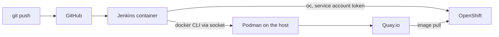

# jenkins-lab

I built this lab to learn Jenkins and OpenShift hands-on: a pipeline that, on every commit, builds a container image, tests it, pushes it to Quay.io and deploys it to OpenShift, with a manual approval step for production.

It runs on my Fedora workstation (Jenkins in a rootless Podman container) and deploys to the OpenShift Developer Sandbox. Some choices here are lab shortcuts, not what I'd do in production (see the last section).

## How it works



Jenkins runs from a custom image (`jenkins/jenkins:lts` + the Docker CLI + `oc`, see `jenkins/Dockerfile`). The Docker CLI talks to the Podman API socket of my user, so images and test containers are actually created by Podman on the host, next to the Jenkins container.

The pipeline (`Jenkinsfile`, declarative, with a `TARGET_ENV` parameter: dev, test or prod):

- **Build**: tags the image as `myapp:<build number>-<short commit hash>` and builds it. No `latest`: every image can be traced back to its commit, and rollback means going back to a known tag.
- **Test**: starts a container from the new image and checks that nginx serves the page. If the check fails, the stage exits non-zero and the pipeline stops.
- **Push**: logs in to Quay.io with a robot account (write access to this repo only) and pushes the image.
- **Approval**: only for `prod`, waits for a manual approval (with a 5 minute timeout). Jenkins records who approved.
- **Deploy**: logs in to OpenShift with a service account token, updates the Deployment with `oc set image` and waits for `oc rollout status`. If the rollout doesn't complete, the stage fails and runs `oc rollout undo`.
- **Post**: always removes the test container and logs out of Quay and OpenShift.

Credentials are stored in Jenkins and used with `withCredentials`. Secrets are in single-quoted `sh` steps, so they are expanded by the shell and not by Groovy, and the Quay login uses `--password-stdin`.

On the OpenShift side, Jenkins uses a `jenkins-deployer` service account with the `edit` role in my project only: it can update Deployments but can't change permissions. The app runs behind a Route with edge TLS termination and an HTTP to HTTPS redirect.

The app image is just two lines on top of `nginx-unprivileged`: non-root, listening on 8080. That's what makes it run unchanged on OpenShift, where containers get a random UID and group 0.

## Things that broke (and what I learned)

- **Permission denied on the Podman socket.** In rootless Podman, root inside the container is my user on the host, but the `jenkins` user maps to a sub-UID with no access to the socket. SELinux was blocking it too. For the lab I run the container as root and disable SELinux labeling for that container only.
- **Git refusing the repo after I changed the container user.** The files in the Jenkins volume still belonged to the old user, and Git's `safe.directory` check refuses repos owned by someone else, even for root. Fixed with `chown`.
- **`Connection refused` on localhost in the test.** BusyBox `wget` resolved `localhost` to `::1`, but nginx was only listening on IPv4. Switched to `127.0.0.1`.
- **Push failing with a 500 and no message.** Login worked, push didn't. Pushing by hand with Podman showed the real error: the repo didn't exist on Quay and the robot account had no write permission. Login succeeding doesn't mean you're allowed to push.
- **Route timing out.** I called the Route on port 8080, the Service port. The router only listens on 80 and 443.
- **Deploy hanging on `rollout status`.** No new pods were created: the Deployment conditions said `DeploymentPaused`. Removing all triggers with `oc set triggers --remove-all` had also removed the config trigger, which pauses the Deployment. Fixed with `oc rollout resume`. Good thing the pipeline waits for the rollout with a timeout: without it, the build would have been green with nothing deployed.

## What I'd do differently in production

- No container engine socket mounted into Jenkins, and no SELinux exceptions. Builds would run on ephemeral agents (one pod per build via the Kubernetes plugin, 0 executors on the controller), with Buildah/Kaniko or OpenShift BuildConfigs to build images.
- Separate projects or clusters for dev, test and prod, with different credentials, promoting the same image between them. In this lab all environments deploy to the same Sandbox project.
- Probably GitOps (Argo CD) for the deploy part: Jenkins would only update the image tag in a config repo, and production credentials would never leave the cluster.

## Run it

```bash
systemctl --user enable --now podman.socket
podman build -t my-jenkins:2 jenkins/
podman run -d --name jenkins -p 8080:8080 \
  -v jenkins_vol:/var/jenkins_home \
  -v /run/user/$(id -u)/podman/podman.sock:/var/run/docker.sock \
  --user root --security-opt label=disable \
  localhost/my-jenkins:2
```

Then create a Pipeline job with "Pipeline script from SCM" pointing to this repo, and add two credentials: `quay-creds` (username/password) and `openshift-token` (secret text, a token for a service account with the `edit` role).

## Next

- [ ] Trigger builds from a GitHub webhook
- [ ] Try the same flow with OpenShift Pipelines (Tekton) or Argo CD
